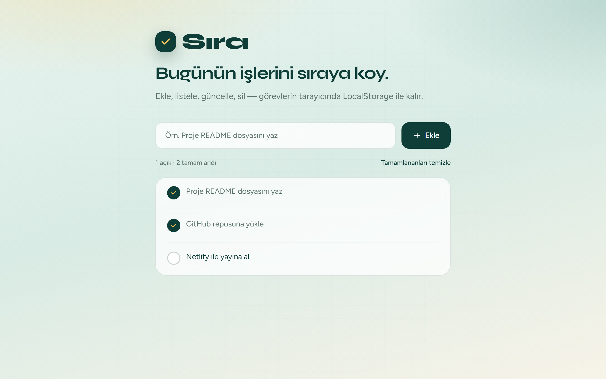

# Sıra — Görev Listesi

React + Vite + Tailwind CSS ile geliştirilmiş, LocalStorage destekli bir TODO (CRUD) uygulaması.

Web Geliştirme / Yapay Zeka proje yönergesine uygun teslim için hazırlanmıştır.

**GitHub:** https://github.com/FFayken/TNC_Grup_Web_Projesi  
**Canlı site:** https://enchanting-syrniki-73b6aa.netlify.app

## Ekran görüntüsü



## Özellikler

- **Ekle** — yeni görev oluşturma
- **Listele** — görevleri görüntüleme
- **Güncelle** — görev düzenleme ve tamamlandı durumu
- **Sil** — görev silme
- Veriler tarayıcı **LocalStorage** içinde saklanır

## Klasör yapısı

```text
src/
  Components/   # BrandHeader, TodoForm, TodoItem, TodoList
  Pages/        # HomePage
  Interfaces/   # Todo tipleri
  hooks/        # useTodos (LocalStorage CRUD)
```

## Kurulum

```bash
npm install
npm run dev
```

Üretim derlemesi:

```bash
npm run build
npm run preview
```

## Teslim checklist

1. Bu repoyu GitHub’da **public** olarak yayınla
2. En az **1 ekran görüntüsü** ekle (ör. `docs/screenshot.png`) ve README’ye koy
3. **Netlify** (veya muadili) ile yayına al
4. GitHub ve canlı site linklerini proje teslim formuna yaz

### Netlify

- Build command: `npm run build`
- Publish directory: `dist`
- Projede `netlify.toml` hazırdır

## Teknolojiler

- React 19
- TypeScript
- Vite
- Tailwind CSS 4
- LocalStorage
